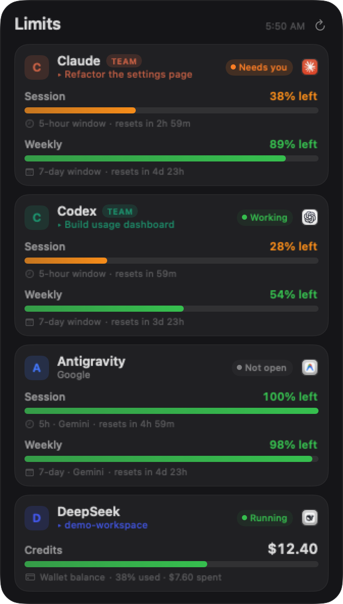
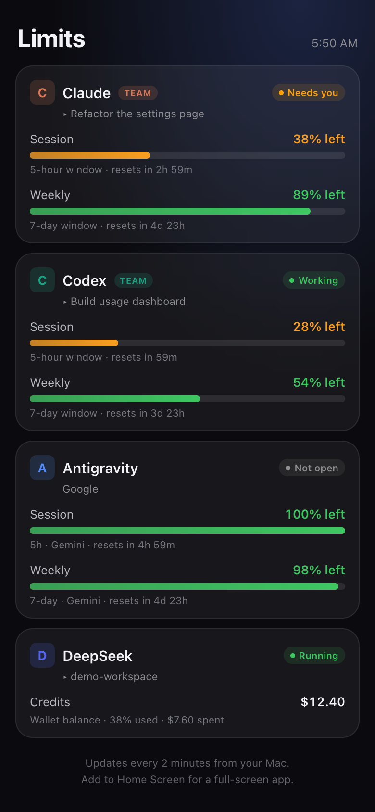

# AI Limits

A macOS desktop widget that shows how much of your **Claude**, **Codex**,
**Antigravity** and **DeepSeek Harness** allowance is left - session and weekly
windows, live session status, and the current wallet balance.



It sits on the wallpaper like a system widget, never floats over your windows,
and can be dragged anywhere. A tiny web bridge serves the same data to a phone
on your network (or over an optional Cloudflare tunnel).



## What it shows

| Card | Source | Shows |
|------|--------|-------|
| Claude | Anthropic usage API, using Claude Desktop's own OAuth token | session (5 h) + weekly (7 d) |
| Codex | ChatGPT usage API, using the Codex CLI token | session (5 h) + weekly (7 d) |
| Antigravity | Google Cloud Code quota API, using the Antigravity app's Keychain session | session (5 h) + weekly (7 d) |
| DeepSeek | Platform user summary, using the DeepSeek Harness account grant | wallet balance + % used |

Each card also shows whether the app is open, whether a session is **working** or
**waiting for you**, the name of the most recent session, and a button (the app's
own icon) to open it.

## Requirements

* macOS 14 (Sonoma) or newer - Apple Silicon or Intel
* Python 3 (`xcode-select --install`) if you want the phone bridge
* At least one supported app installed and signed in - the widget reads the
  session that app already keeps on this Mac

## Install

### From a release (easiest)

Download `AI-Limits.zip` from [Releases](../../releases), unzip it, then:

```bash
cd ~/Downloads/AI-Limits
bash install.sh              # add --tunnel for internet access
```

### From source

```bash
git clone https://github.com/saisubu1997/ai-limits.git
cd ai-limits
./install.sh
```

`install.sh` builds the app with `swiftc`, installs it to `~/Applications`, and
registers two login agents (`com.sai.ailimits`, `com.sai.ailimits.web`).

**First launch asks for Keychain access twice** ("Claude Safe Storage" and the
Antigravity key). Choose **Always Allow** - the widget only decrypts the token
your own app already stored, and caches what it needs in `~/.limitswidget`.

## Using it

* **Drag** the card anywhere - the whole card is a handle. Corner positions stay
  pinned to the corner when the card grows.
* **Right-click** for refresh, *Move to* a screen corner, reset position, quit.
* **Menu bar gauge icon** mirrors those actions and opens each app.

### Phone

The installer prints a URL like `http://Your-Mac.local:8787/t/<token>/`.
Open it on a phone on the same Wi-Fi, then **Share -> Add to Home Screen**.
Every request re-checks the data, so the page is never more than a couple of
minutes stale.

For access from anywhere, install with `--tunnel`; a Cloudflare quick tunnel
publishes the same page over HTTPS and prints its URL to
`~/.limitswidget/cloudflared.log`. The hostname changes whenever the tunnel
restarts.

There is also a [Scriptable](https://scriptable.app) widget in
[`ios/ailimits.js`](ios/ailimits.js) for a real home-screen widget - paste it in
and replace the token placeholder.

## Privacy and security

* Everything runs locally. Nothing is uploaded to any server - the widget calls
  the same vendor endpoints your apps already call, with the credentials those
  apps already store.
* The Keychain is read **once** per credential; derived material is cached in
  `~/.limitswidget` with mode `0600`.
* The phone page is protected only by the 48-bit token in its path. Treat the
  public tunnel URL like a password, and rotate the token by deleting
  `~/.limitswidget/web_token` and re-running `./install.sh`.
* The web bridge binds `0.0.0.0:8787` on your LAN; it is not exposed to the
  internet unless you run the tunnel.

## How the data is read

| Provider | Credential | Endpoint |
|----------|------------|----------|
| Claude | `oauth:tokenCacheV2` in `~/Library/Application Support/Claude/config.json`, decrypted with the `Claude Safe Storage` Keychain key | `api.anthropic.com/api/oauth/usage` |
| Codex | `~/.codex/auth.json` | `chatgpt.com/backend-api/wham/usage` |
| Antigravity | Keychain item `gemini` / `antigravity` (the desktop app's Google session), refreshed in-process | `cloudcode-pa.googleapis.com/v1internal:retrieveUserQuotaSummary` |
| DeepSeek | `~/.dsh/.credentials.yaml` | `platform.deepseek.com/api/v0/users/get_user_summary` |

### Known limits

* **Waiting for you** is a transcript heuristic: Claude's newest record is an
  unanswered `tool_use`. A slow tool looks the same as a permission prompt.
* **Antigravity** exposes no session title, so that card keeps the vendor line.
* **DeepSeek** sessions are zstd-compressed and the session title falls back to
  the workspace folder name.
* Values are read from local state, so a provider has to have been used at least
  once on this Mac before its card fills in.
* The Antigravity OAuth client is read out of the installed app at runtime (no
  Google credentials are stored in this repository). If your install lives
  somewhere unusual, set `AILIMITS_AG_CLIENT_ID` and `AILIMITS_AG_CLIENT_SECRET`.

## Development

```bash
./build.sh          # compile AILimits.app (universal) into this folder
./package.sh        # build dist/AI-Limits.zip for another Mac
```

`demo/data.json` holds fictional accounts so the UI can be worked on without
real credentials:

```bash
AILIMITS_HOME=$PWD/demo ./AILimits.app/Contents/MacOS/AILimits --snapshot out.png
AILIMITS_HOME=$PWD/demo AILIMITS_WEB_PORT=8788 python3 serve.py
```

Layout:

```
fetch.py            data collection (python3 stdlib only)
serve.py            phone bridge: /t/<token>/ page + api.json
Sources/main.swift  app shell, desktop panel, menu bar, Keychain bootstrap
Sources/Model.swift data model + refresh loop
Sources/Views.swift SwiftUI widget UI
ios/ailimits.js     Scriptable home-screen widget
```

## Uninstall

```bash
launchctl bootout gui/$(id -u)/com.sai.ailimits
launchctl bootout gui/$(id -u)/com.sai.ailimits.web
launchctl bootout gui/$(id -u)/com.sai.ailimits.tunnel   # if installed
rm -rf "$HOME/Applications/AI Limits.app" \
       "$HOME/Library/LaunchAgents"/com.sai.ailimits*.plist \
       "$HOME/.limitswidget"
```

## License

MIT - see [LICENSE](LICENSE).
