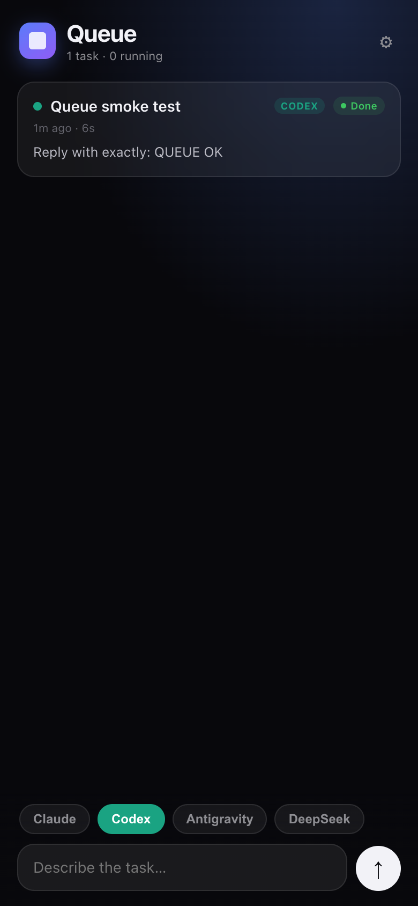

# Work queue

A phone-first PWA for handing tasks to your agents, served from the same Mac bridge
as the limits widget. Installable on iPhone (Share -> Add to Home Screen).



`http://<your-mac>.local:8787/t/<token>/queue/`

## How it works

1. Describe a task and pick a model.
2. The Mac runs it headlessly with that app's own CLI.
3. Output streams back into the card, and the status goes queued -> running -> done/failed.

## Which models can actually run

| Model | Runner | Notes |
|-------|--------|-------|
| Claude | the Claude Code CLI bundled inside Claude.app | authenticated with the OAuth token already stored by Claude Desktop (`CLAUDE_CODE_OAUTH_TOKEN`) |
| Codex | `codex-cli` bundled inside the ChatGPT app | uses the existing `~/.codex/auth.json` |
| Antigravity | none | the desktop app has no CLI, so the task is marked **Manual** - open the app and paste it |
| DeepSeek | none | same: the Harness has no CLI, so it is marked **Manual** |

Tasks are honest about this: a Manual card says so instead of pretending to run.

**Open <App>.** Every card has an action that brings the matching Mac app forward
(`open -b <bundle-id>`, falling back to the .app path). It is shown inline on Manual
cards so you can hand the task straight over, and in the expanded actions on the rest.
Tapping it from your phone opens the app **on the Mac**.

## Supabase sync (optional)

Sync makes the queue visible across devices: queue a task on the phone, the Mac picks
it up and runs it. Without it everything stays local in `~/.limitswidget/queue.db`.

1. Create a project at [supabase.com](https://supabase.com) (free tier is enough).
2. Open **SQL editor**, paste [`../supabase.sql`](../supabase.sql), run it.
3. Connect from this Mac:

   ```bash
   ./connect-supabase.sh https://YOUR-PROJECT.supabase.co YOUR_ANON_KEY
   ```

   That saves the credentials, checks the table, queues a test task and waits until it
   appears in Supabase. You can also paste the same values in the app's gear menu.

4. On the phone, open the queue, gear, and enter the same URL + anon key. Tasks queued
   on the phone are pulled by the Mac every 8 seconds and executed.

**Security:** the bundled policy lets anyone holding the anon key read and write the
table. That is fine for a private project, but do not publish the key, and tighten the
RLS policy (or add Supabase auth) if the project is shared.

## Hosting on Supabase (auth built in)

> Storage serves `.html` as `text/plain` on purpose, so a Storage URL shows source.
> For a `*.supabase.co` app URL use the Edge Function in `hosted/function/`:
> `SUPABASE_ACCESS_TOKEN=sbp_... ./hosted/deploy-function.sh` -> `/functions/v1/sai-agents`.

Supabase serves the app from Storage and provides the login.

1. **SQL editor** -> run [`supabase.sql`](../supabase.sql). It creates `public.tasks`
   and the public `app` bucket.
2. **Publish:**

   ```bash
   ./host-supabase.sh https://YOUR-PROJECT.supabase.co YOUR_ANON_KEY YOUR_SERVICE_ROLE_KEY
   ```

   The script inlines the CSS/JS/icons into one HTML file, bakes in the project URL and
   anon key, uploads it, and prints the public URL:
   `https://YOUR-PROJECT.supabase.co/storage/v1/object/public/app/sai-agents.html`

3. Open that URL (or add it to your iPhone home screen). Sign in with email/password or
   a magic link. Tasks go straight to Postgres; the Mac runner picks them up.

Notes:
* `service_role` is only used for the upload and never leaves your Mac. The anon key is
  public by design and is embedded in the page.
* Email confirmation is on by default: confirm the message before the first sign-in, or
  turn it off under **Authentication -> Providers -> Email**.
* Point the Mac app at the hosted build with
  `echo https://YOUR-PROJECT.supabase.co/storage/v1/object/public/app/sai-agents.html > ~/.limitswidget/agents_app_url`.

## Hosted copy (GitHub Pages)

GitHub Pages serves a hosted build of the same UI:

**https://saisubu1997.github.io/ai-limits/queue/**

It talks to Supabase instead of the Mac, so it works anywhere. Flow:

1. Open the page, paste your project **URL** and **anon key** (the setup card).
2. **Create account** -> confirm the email (Supabase sends it) -> **Sign in**.
3. Queue tasks on the phone; they land in `public.tasks` with `status='queued'`.
4. The Mac, connected to the same project (`./connect-supabase.sh`), pulls them every
   8 seconds, runs the CLI, and pushes the output back.
5. "Open app" from the hosted UI writes a row with `action='open'`; the Mac executes it.

Notes:

* The anon key is public by design; the `service_role` key must never be pasted anywhere.
* Email confirmation is on by default in new Supabase projects - confirm before signing in,
  or turn it off in **Authentication -> Providers -> Email**.
* The bundled RLS policy is permissive so the unauthenticated Mac runner can write. Tighten
  it (and give the runner its own account) before sharing the project.

## Requirements

* macOS with the limits widget installed (`../install.sh`)
* Claude Desktop signed in for Claude runs; the ChatGPT/Codex app for Codex runs
* Optional: `pip3 install --user zstandard` (only affects DeepSeek titles on the limits card)

## Files

```
server.py             task store (SQLite), runner, REST API, Supabase sync
web/                  the PWA (installable, offline shell)
connect-supabase.sh   one-shot Supabase setup + verification
```

Tasks live in `~/.limitswidget/queue.db`; delete a row from the UI or drop the file to reset.
